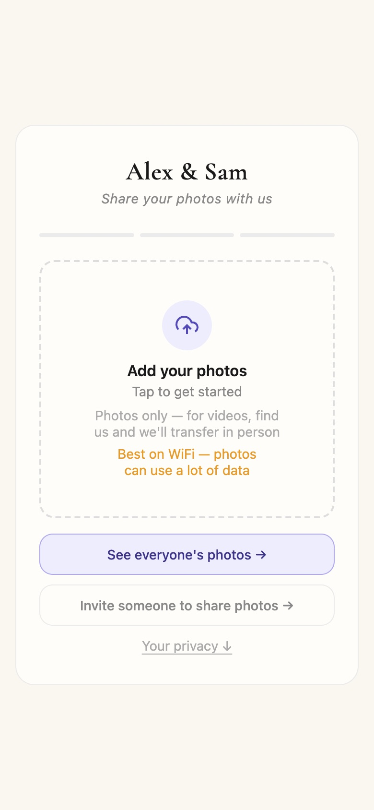
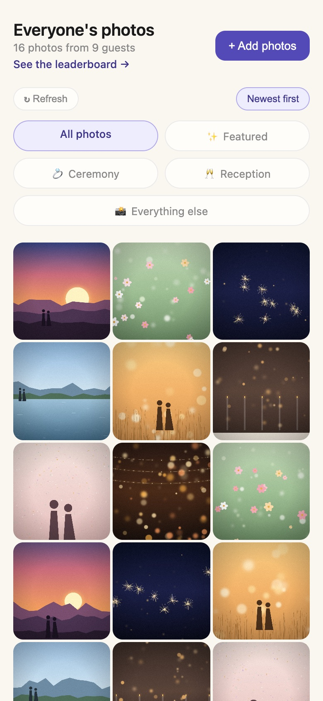
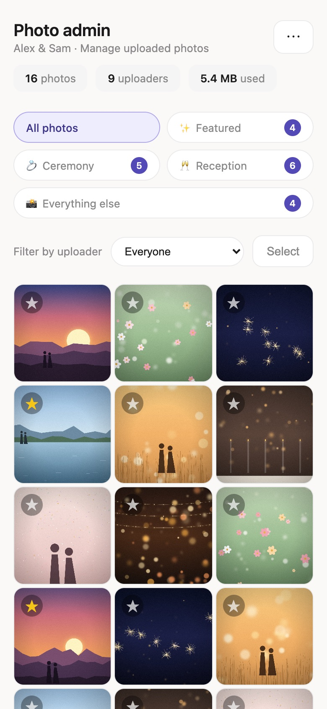

# Wedding Photos

A private photo-sharing site for your wedding, running on your own Cloudflare
account, usually for free.

Guests scan a QR code on the table, type their name, and upload photos straight
from their phone. Everyone can browse the gallery, filter by moment ("Ceremony",
"Reception"…), and like their favourites. You get an admin page to star, rename,
delete and download everything as ZIP files.

- **Private:** guests need your passphrase (the QR code includes it). Search
  engines and AI crawlers are blocked.
- **Yours:** photos are stored in your own Cloudflare account, not on someone
  else's service, and nobody else can see them.
- **No app to install:** it works in any phone browser, and HEIC photos from
  iPhones are converted automatically.
- **No code to edit:** names, locations, passphrase and theme are all set from
  the admin page.

<table>
  <tr>
    <td align="center" width="33%">
      <picture>
        <source media="(prefers-color-scheme: dark)" srcset="docs/images/guest-home-dark.jpg">
        
      </picture>
      <br><sub><b>Guests:</b> add photos from their phone</sub>
    </td>
    <td align="center" width="33%">
      <picture>
        <source media="(prefers-color-scheme: dark)" srcset="docs/images/gallery-dark.jpg">
        
      </picture>
      <br><sub><b>Gallery:</b> filter by moment, like favourites</sub>
    </td>
    <td align="center" width="33%">
      <picture>
        <source media="(prefers-color-scheme: dark)" srcset="docs/images/admin-dark.jpg">
        
      </picture>
      <br><sub><b>Admin:</b> star, rename, delete, download</sub>
    </td>
  </tr>
</table>

<sub>Screenshots use illustrated sample photos. Every page follows the phone's light or dark setting.</sub>

---

## What it costs

For a typical wedding, **nothing**. Everything fits inside Cloudflare's free
allowances:

| Service | What it's for | Free allowance |
|---|---|---|
| Workers | Runs the site | 100,000 requests a day |
| R2 | Stores the photos | 10 GB (about 2,000–3,000 phone photos) |
| D1 | Photo list, likes and settings | 5 GB |
| Images | Makes small, fast versions of each photo | 5,000 a month (2 per photo) |
| Queues and KV | Background work and spam protection | Plenty for a wedding |

Things to know:

- **R2 asks for a payment card** before you can switch it on, even though you
  stay inside the free 10 GB. Beyond that it's $0.015 per GB a month.
- **More than about 2,500 photos in one month** goes past the free Images
  allowance. Nothing breaks and you aren't charged: the extra photos simply show
  full size in the gallery, so it loads more slowly.
- **A custom domain** (like `photos.alexandsam.com`) is optional and costs
  whatever your registrar charges, typically $10–15 a year. Without one, your
  site lives at a free `….workers.dev` address.

---

## Before you start

You'll need:

1. **A Cloudflare account.** Free at [dash.cloudflare.com/sign-up](https://dash.cloudflare.com/sign-up).
2. **R2 switched on.** In the Cloudflare dashboard, open **R2 Object Storage**
   and follow the steps (this is where the card is asked for).
3. Either a **GitHub account** (for Option A) or **Node.js 20 or newer**
   on your computer (for Option B, from [nodejs.org](https://nodejs.org)).

Allow about 15 minutes.

---

## Option A: Deploy with one click

[](https://deploy.workers.cloudflare.com/?url=https://github.com/OzzieBuilds/wedding-photos-kit)

1. Click the button above and sign in to Cloudflare and GitHub when asked.
2. Leave the suggested names as they are and click **Create and deploy**.
   Cloudflare copies this project into your GitHub account and creates the
   storage and database for you.
3. When it finishes, open your new site's address **with `/admin` on the end**,
   for example `https://wedding-photos.yourname.workers.dev/admin`.
4. **Create your admin password straight away.** Until you do, the first person
   to open `/admin` gets to choose it. Nobody is likely to find the address
   before you, but don't wait.

Then carry on with [First-time setup](#first-time-setup).

With this option, any change pushed to your copy on GitHub redeploys the site
automatically.

## Option B: Deploy from your computer

Download this project ([Code → Download ZIP](../../archive/refs/heads/main.zip)
on GitHub, or `git clone`), unzip it, then open a terminal in that folder and run:

```bash
npm install
npm run setup
```

The setup script:

1. Opens your browser to sign in to Cloudflare.
2. Asks you to choose your admin password.
3. Deploys the site. The first time, this also creates your photo storage,
   database and queue, and saves their IDs in `wrangler.toml`.
4. Sets your admin password on the new site and prints its address.

**Keep the folder,** and `wrangler.toml` in particular. Running `npm run setup`
again from it redeploys the same site without touching your photos or settings.

> `npm install` may print warnings about install scripts. They are safe to
> ignore: the site deploys without them.

---

## First-time setup

Sign in at your site's `/admin` page, open the **⋯** menu, then **Settings**:

1. **Wedding setup → Couple:** your two first names. They appear on every page
   guests see.
2. **Time zone:** filled in from your device. Change it if the wedding is
   somewhere else, so the photo stats show local times.
3. **Theme ›:** choose how the site looks. Each choice shows a live preview.
   To make your own, tap **How to make one**: it copies a prompt for Claude,
   and **Import theme** adds the CSS file Claude gives you. No redeploy needed.
4. **Locations ›:** one to four moments guests can file photos under, each with
   an emoji. These lock once photos arrive, so set them first.
5. **Guest access ›:** choose the passphrase guests will use (4–40 letters,
   numbers or hyphens, and not case-sensitive). Then **Download PNG** for a
   print-ready QR code that signs guests straight in. **Until you set a
   passphrase, no guest can get in.**
6. **Site mode:** **Pre-wedding** shows guests a "back soon" page, and
   **Live** lets them in.

Try it yourself: scan the QR code with your phone and upload a few photos. To
clear test photos afterwards, switch to **Pre-wedding**, tap **Select →
Select all → Delete**, then switch back.

### Using your own domain (optional)

1. Add your domain to Cloudflare (dashboard → **Add a domain**) if it isn't
   there already.
2. **Workers & Pages → wedding-photos → Settings → Domains & Routes → Add →
   Custom domain**, for example `photos.yourdomain.com`.
3. **Images → Transformations:** enable it for that domain, so the gallery
   gets its small, fast versions of each photo.

Links, sign-in, the invite link and the QR code all follow whichever address
the site is opened on. Download the QR code again after switching.

---

## Before the wedding: checklist

- [ ] Names, time zone, theme and locations set
- [ ] Guest passphrase set, QR code downloaded **and scanned with a phone**,
      both on screen and once printed
- [ ] Upload, gallery, likes and lightbox tested on an iPhone and an Android
- [ ] Admin tested: star, delete, download all
- [ ] Test photos cleared (Pre-wedding → Select → Select all → Delete)
- [ ] Site mode switched to **Live** on the day. This also turns on photo
      repair, which quietly rebuilds any small versions that fail when lots of
      photos arrive at once.

## After the wedding

- **Download everything:** admin → ⋯ → **Download all photos**. Do this on a
  laptop: the browser builds the ZIP files itself, which is slow on a phone.
  Photos that arrive later can be downloaded with **Select → ⬇ Download**, and
  their file names continue the same numbering.
- **Close it:** Site mode → **Post-wedding** keeps guests who are already
  signed in and shows everyone else a "photos are now private" page.
- **Photo repair:** turn it off in Settings once photos stop arriving.

---

## If something goes wrong

**Guests can't sign in.** Check Settings → Guest access. If it says "Not set",
no passphrase has been saved yet.

**Photos won't upload.** Usually it's the venue's signal. Ask guests to use the
Wi-Fi. Uploads retry by themselves before offering "Try again".

**The gallery is slow, or shows full-size photos.** The small versions come
from Cloudflare Images. On a custom domain, check that **Images →
Transformations** is enabled for that domain. Also check you haven't used the
5,000 free transformations this month.

**I forgot the admin password.** In the Cloudflare dashboard open **Storage &
Databases → D1**, choose the database whose name starts with `wedding-photos`,
open its **Console**, run
`DELETE FROM config WHERE key = 'admin_password_hash';`, then open your site's
`/admin` straight away and create a new one. Your photos and settings are
untouched.

**The site needs to come down right now.** **Workers & Pages → wedding-photos →
Settings → Variables and Secrets**: add a variable `MAINTENANCE_MODE` with the
value `true`. Everything, admin included, shows a holding page until you
delete it.

**Something else.** Check [cloudflarestatus.com](https://www.cloudflarestatus.com),
then the Worker's logs: **Workers & Pages → wedding-photos → Logs**.

---

## Updating to a newer version

- **Option A (GitHub copy):** on your copy's GitHub page, click **Sync fork**
  if it's offered. Otherwise, download the new version and replace the files
  in your copy, keeping your `wrangler.toml`. Cloudflare redeploys on its own.
- **Option B (folder on your computer):** replace everything except
  `wrangler.toml` with the new version, then run `npm install` and
  `npm run setup`.

Your photos, likes and settings are kept. The database upgrades itself on the
first visit after an update.

---

## For developers

- [docs/ARCHITECTURE.md](docs/ARCHITECTURE.md): how it works, the API routes,
  security, the database, and tests.
- [docs/THEMES.md](docs/THEMES.md): building a new theme. It's written so you
  can hand it to an AI coding assistant.
- `npm test` runs the tests, with no Cloudflare account needed.
- `npx wrangler dev` runs the site locally. Add
  `--var ADMIN_PASSWORD:devadmin` to skip the first-visit password screen.

## License

MIT. See [LICENSE](LICENSE).
